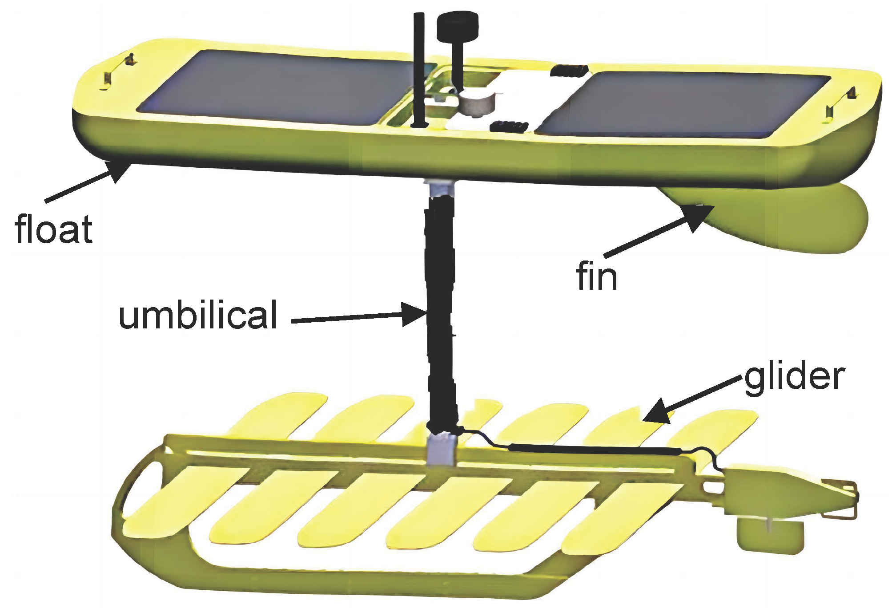

[Vidéo explicative sur YouTube](https://youtu.be/m7gmf4Mfba4?si=N-2qKUcW1980YK0m)

## Présentation

**Liquid Robotics** est une entreprise américaine spécialisée dans la robotique marine autonome. Elle conçoit et fabrique le *Wave Glider*, un drone de surface sans pilote (USV, *Unmanned Surface Vehicle*) alimenté par l'énergie solaire et par l'énergie des vagues, qu'il utilise pour se propulser. L'engin peut ainsi rester plusieurs mois d'affilée en mer pour collecter et transmettre des données océaniques.

Ses applications relèvent surtout de la défense, de la surveillance maritime, de l'industrie pétrolière et gazière et de la recherche scientifique, par exemple :

- la surveillance d'infrastructures pétrolières et gazières, de l'atmosphère, de l'activité sismique et de l'environnement ;
- la défense (lutte anti-sous-marine, renseignement, surveillance et reconnaissance) ;
- la surveillance maritime (détection de navires pour la sécurité des côtes et des frontières) ;
- la recherche scientifique (données météorologiques, climatiques et sismiques en haute mer, mesure de l'acidification des océans, suivi des écosystèmes et des populations de poissons).

Il embarque des batteries et des capteurs atmosphériques et océanographiques utiles aux sciences du climat, des capteurs sismiques pour détecter les tremblements de terre et les tsunamis, ainsi que des caméras et des hydrophones pour la sécurité, la surveillance, la recherche ou la protection du milieu marin.

Depuis 2007, des Wave Gliders ont été déployés de l'Arctique à l'océan Austral : pour suivre les grands requins blancs avec la chercheuse Barbara Block (Hopkins Marine Station), pour patrouiller dans des aires marines protégées contre la pêche illégale pour le compte du Foreign & Commonwealth Office britannique, ou encore pour évaluer la santé de la Grande Barrière de corail. Ils ont aussi collecté et transmis des données pendant des tempêtes extrêmes, et ont permis de détecter et de suivre un sous-marin diesel lors de l'exercice *Unmanned Warrior* en octobre 2016.

## Conception

Le *Wave Glider* se compose de deux parties :

- le **flotteur**, à peu près de la taille et de la forme d'une grande planche de surf, qui se déplace à la surface de l'océan ;
- le **glider** (support d'ailes), suspendu sous le flotteur par un câble de 4 à 8 mètres, équipé d'un gouvernail pour se diriger et d'un propulseur qui fournit une poussée supplémentaire dans les conditions difficiles (turbulences, absence de courant ou courant fort).

 

Les ailes peuvent pivoter sur une plage d'environ 60 degrés, ce qui leur donne toujours une inclinaison favorable à la poussée du flotteur vers l'avant.

Le *Wave Glider* exploite la différence de mouvement entre la surface de l'océan et l'eau plus calme en profondeur pour avancer. Plus précisément, quand la houle soulève puis abaisse le flotteur, le glider monte et descend avec lui : la portance et la traînée qui s'exercent alors sur les ailes produisent une force qui tire toujours le flotteur vers l'avant.

Aucun carburant n'est nécessaire, ce qui lui permet de rester en mer pendant de longues périodes.

## Évolutions

Le 7 septembre 2017, Liquid Robotics a annoncé un *Wave Glider* de nouvelle génération, adapté aux mers très agitées ([état de la mer 6 et plus](https://fr.wikipedia.org/wiki/État_de_la_mer)) et aux eaux froides des hautes latitudes. Il embarque davantage de capteurs et dispose d'une plus grande capacité d'énergie et de stockage, nécessaire aux longues missions de surveillance maritime, de suivi environnemental et d'observation.
