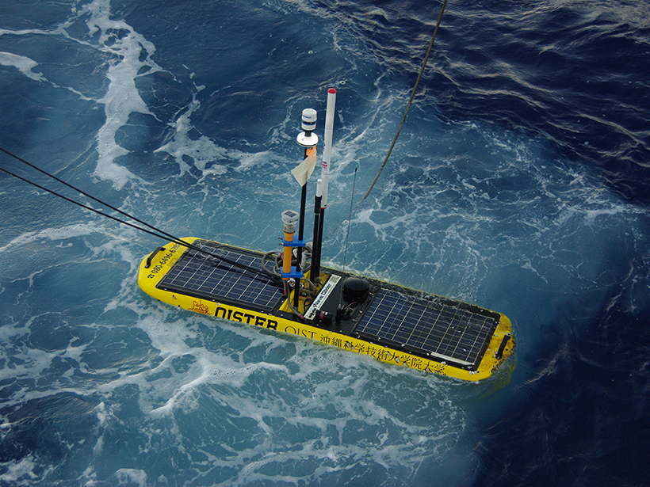

### Bibliographie

[Lien vers une vidéo YouTube explicative](https://youtu.be/m7gmf4Mfba4?si=N-2qKUcW1980YK0m)

**Liquid Robotics** est une société américaine spécialisée dans le domaine de la robotique marine et sous-marine autonomes, qui conçoit et fabrique le *Wave Glider*, un véhicule de surface et subsurface, planeur sous-marin sans pilote (USV) alimenté par l'énergie solaire et celle des vagues (le *Wave Glider* récupère l'énergie des vagues océaniques pour la propulsion). L'engin peut ainsi passer plusieurs mois d'affilée en mer, collectant et transmettant des données océaniques. 

Les applications sont surtout de défense, de surveillance maritime, commerciales, pétrolières et gazières, scientifiques et de recherche, avec par exemple :

-  Monitoring d'infrastructures pétro-gazières, de l'atmosphère, sismique et environnemental
- Défense (Lutte anti-sous-marine, renseignement, surveillance et reconnaissance...)
- Surveillance maritime (détection d'engins de surface pour la sécurité côtière et frontalière)
- Recherche scientifique (acquisition de données météorologique, climatique, sismique en haute mer, mesure de l'acidification des océans, surveillance environnementale, recherche bio géophysique et surveillance des poissons/écosystèmes, etc.).

Il emporte une charge utile de batterie et de capteurs atmosphériques et océanographiques (par exemple utiles pour l'océanographie et aux sciences du climat), des capteurs sismiques pour la détection des tremblements de terre et des tsunamis, ainsi que des caméras vidéo et des capteurs acoustiques (hydrophones) à des fins de sécurité, de surveillance, d'étude et/ou de protection de l'environnement marin.

Depuis 2007, des Wave Gliders ont été déployés de l'Arctique à l'océan Austral, par exemple pour suivre les grands requins blancs par le Dr Barbara Block of Hopkins Marine Station, patrouiller dans des aires marines protégées (AMP) pour le Foreign & Commonwealth Office du Royaume-Uni afin de se protéger contre la pêche illégale , pour évaluer la santé de la Grande Barrière de Corail et d'autres écosystèmes. Ils ont aussi permis de collecter et de transmettre des données lors de tempêtes extrêmes mais aussi la détection et le suivi d' un sous-marin diesel lors de l'exercice *Unmanned Warrior* d'octobre 2016.

### DESIGN

Le *Wave Glider* est composé de deux parties : 

- Le « flotteur », à peu près de la taille et de la forme d'une grande planche de surf, se déplace à la surface de l'océan ;

- Le *rack d'aile*, est suspendu en dessous, attaché à un cordon ombilical de 4 à 8 mètres de long, équipé d'un gouvernail pour la direction et d'un propulseur fournissant une poussée supplémentaire dans des conditions extrêmes (turbulence, absence de courants ou courant élevé).

                                  

  ​     

Une contrainte est appliquée sur les ailes, celles-ci peuvent se tourner dans une plage d’angle d’environ 60 degrés, permettant une inclinaison qui soit toujours favorable à la poussée en avant du flotteur.

Le *Wave Glider* exploite la différence de mouvement entre la surface de l'océan et l'eau plus calme en dessous pour créer une propulsion vers l'avant. 

Plus précisement, une force de portance couplée à une force de trainée principalement due au mouvement de translation du flotteur sur la surface de l’eau (due à la houle) assurent que les ailes contribuent à toujours tirer le flotteur vers l’avant.

Aucun carburant n'est requis pour son fonctionnement, ce qui lui permet de rester en mer pendant de longues périodes.

Le 7 septembre 2017, Liquid Robotics a annoncé un *Wave Glider* de nouvelle génération, adapté aux missions dans les mers très agitées ([état de la mer 6 et plus](https://fr.wikipedia.org/wiki/État_de_la_mer#Description_de_l'état_de_la_mer)) et froides (aux hautes latitudes). 

Sa charge utile de capteurs a augmenté, de même que sa capacité énergétique et de stockage (capacité requise pour les missions de surveillance maritime, de surveillance environnementale et d'observation de longue durée).