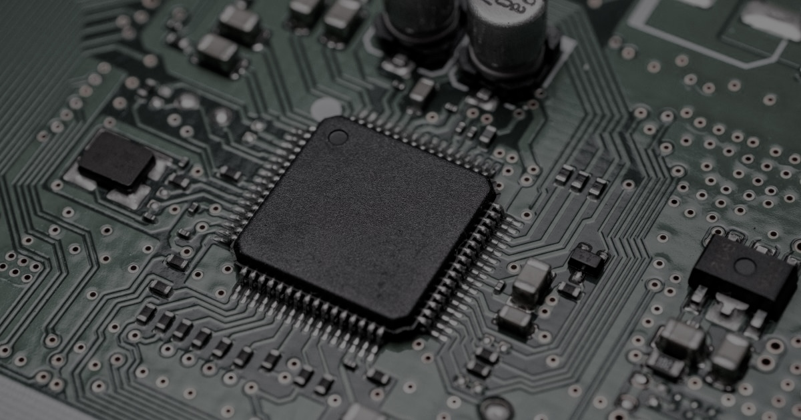

{.project-cover .nolightbox}

## En bref

| | |
|:--|:--|
| **Cadre** | Projet de 1ʳᵉ année, ENSEA, 2025–2026 |
| **Équipe** | 5 étudiants |
| **Mon rôle** | Schéma et routage du PCB, firmware et tests du capteur ToF et du module radio |
| **Outils** | KiCad, STM32CubeIDE (HAL), C, PuTTY, Onshape, Git/GitHub |

## Objectif

PC_BOT est un petit robot à roues destiné à **cartographier une pièce**. Plusieurs robots se placent sur le périmètre, se déplacent de façon autonome en évitant les obstacles et échangent leurs positions par radio. Chaque robot transmet en continu à une station de base ses distances aux obstacles, son orientation, sa vitesse et son accélération, pour reconstruire une représentation 2D de la pièce.

## Cahier des charges

| Fonction | Solution retenue |
|:--|:--|
| Mobilité autonome | 2 motoréducteurs CC pilotés en PWM par un driver **DRV8411A** |
| Perception des obstacles | Capteur temps de vol **VL53L0X** (I2C) |
| Orientation et mouvement | Centrale inertielle **LSM6DSOX** (I2C) |
| Communication | Module radio **nRF24L01+** à 2,4 GHz (SPI) |
| Énergie | Batterie Li-ion **18650** (3400 mAh), chargeur **BQ25896** via USB-C, régulateur 3,3 V |
| Unité centrale | Microcontrôleur **STM32G431KBT6** |

## Architecture matérielle

```{mermaid}
graph LR
    MCU[STM32G431KBT6]

    subgraph BUS_I2C [Bus I2C]
        TOF[Capteur ToF VL53L0X]
        IMU[IMU LSM6DSOX]
        BQ[Chargeur BQ25896]
    end

    subgraph BUS_SPI [Bus SPI]
        NRF[Module nRF24L01+]
    end

    subgraph POWER [Alimentation]
        BAT[Batterie 18650]
        USB[Prise USB-C]
    end

    subgraph MOTORS [Motorisation]
        DRV[Driver DRV8411A]
        M1[Moteurs CC]
    end

    MCU -- "SDA / SCL" --- BUS_I2C
    MCU -- "MOSI / MISO / SCK" --- BUS_SPI
    MCU -- "PWM" --- DRV
    DRV --- M1

    USB -- "Charge" --- BQ
    BAT -- "Énergie" --- BQ
    BQ -- "VCC" --- MCU

    NRF -. "Radio 2,4 GHz" .-> Station[Station de base]
```

Les capteurs (ToF, IMU, chargeur) partagent un **bus I2C** avec des pull-up de 4,7 kΩ. Le module radio est sur un **bus SPI**, plus rapide et full-duplex, pour envoyer les données en continu. Le STM32 se programme et se débogue par un connecteur **ST-LINK** (SWD).

## Ce que j'ai fait

**Conception du PCB (KiCad).** Schéma complet puis routage d'une carte **4 couches** en composants CMS : microcontrôleur, chaîne de charge Li-ion (BQ25896 avec son inductance de 1 µH, connecteur USB-C), régulation 3,3 V, driver moteur, connecteurs des capteurs et du module radio, LED d'état et boutons. Chaque choix de composant a été vérifié dans sa datasheet.

**Firmware C (STM32CubeIDE).** Avant d'avoir la carte finale, chaque capteur a été validé sur une carte de développement STM32 :

* **Capteur ToF** : lecture des distances en I2C. Le capteur détecte les obstacles d'environ 3 cm à un peu moins d'un mètre, avec une portée qui varie selon la lumière ambiante.
* **Liaison radio** : communication entre deux cartes STM32 équipées chacune d'un nRF24L01+, en émission et en réception, avec affichage des trames reçues dans PuTTY.

**Assemblage et mise en service.** Soudure des composants CMS, puis tests capteur par capteur sur la carte finale.

## Ce que j'en retiens

La conception du PCB a été la partie la plus longue et la plus formatrice : partir d'un cahier des charges réel pour aboutir à une carte fabriquée. Le projet m'a aussi appris qu'une erreur de routage ou de soudure peut vite provoquer un court-circuit et endommager la carte et ses capteurs, d'où l'importance de tester chaque bloc séparément.

📁 [Dépôt GitHub du projet](https://github.com/rahim974/2526_projet1a_pcbot1) (schémas KiCad, BOM, firmware de test)

<div style="margin-top: 40px; text-align: center;">
  <a href="../projets.qmd" class="btn btn-outline-secondary">
    <i class="bi bi-arrow-left"></i> Retour aux projets
  </a>
</div>
