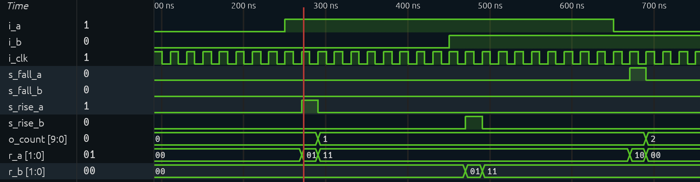
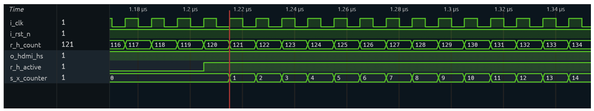
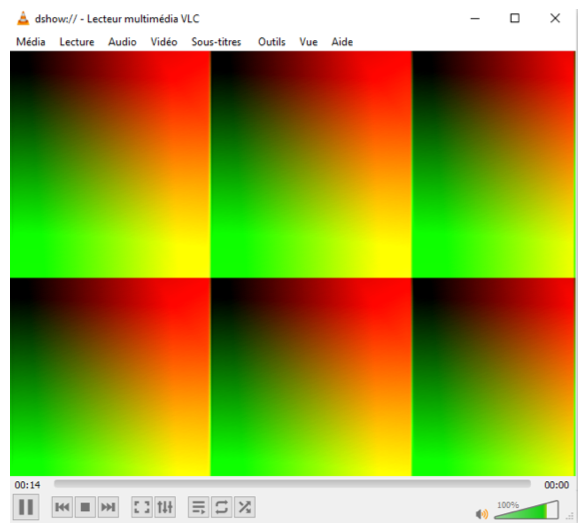
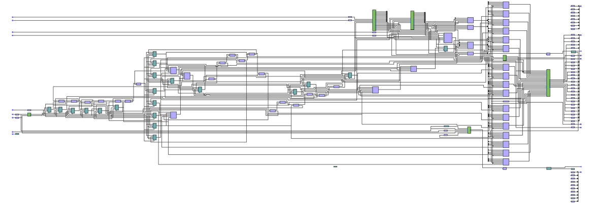

## En bref

| | |
|:--|:--|
| **Cadre** | Projet de TP FPGA, ENSEA, 2026–2027 |
| **Équipe** | Binôme |
| **Matériel** | Carte DE10-Nano (FPGA Intel Cyclone V SoC 5CSEBA6U23I7), carte mezzanine avec 2 encodeurs rotatifs et 10 LED |
| **Outils** | VHDL, Quartus Prime, NVC et Surfer (simulation), VLC avec un adaptateur HDMI vers USB |
| **Résultat** | Écran magique complet : dessin en 720×480 par HDMI, trait mémorisé, effacement par bouton |

## Objectif

Recréer en numérique l'**écran magique** (le « télécran ») : deux boutons rotatifs déplacent un stylet qui dessine sur un écran. Ici, les boutons sont deux **encodeurs rotatifs** et le dessin s'affiche par la **sortie HDMI** de la carte.

Le projet a avancé brique par brique, en suivant à chaque fois la même démarche : **schéma, VHDL, simulation, puis test sur la carte**.

## Architecture

```{mermaid}
flowchart LR
    ENC_G[Encodeur gauche] --> DEC_X[Décodeur X]
    ENC_D[Encodeur droit] --> DEC_Y[Décodeur Y]
    DEC_X -- "x stylet" --> A[Port A<br/>écriture]
    DEC_Y -- "y stylet" --> A
    BTN[Bouton gauche] --> CLR[Effacement]
    CLR --> A
    A --> RAM[(Mémoire dual-port<br/>720 × 480)]
    CTRL[Contrôleur HDMI] -- "adresse pixel" --> B[Port B<br/>lecture]
    B --> RAM
    RAM -- "couleur" --> ADV[Puce HDMI ADV7513]
    CTRL -- "HS / VS / DE" --> ADV
    ADV --> ECRAN([Écran])
```

## 1. Gestion des encodeurs

Un encodeur rotatif fournit deux signaux A et B décalés d'un quart de période : l'ordre dans lequel ils changent donne le sens de rotation. Le décodeur détecte les fronts de A et B et incrémente ou décrémente un compteur de taille configurable.

* **Synchronisation** : A et B ne sont pas synchronisés sur l'horloge du FPGA. Ils passent donc par deux bascules avant toute détection de front, pour éviter la métastabilité.
* **Anti-rebond** : sur la carte, un seul cran faisait parfois bouger le compteur de plusieurs unités. Les contacts mécaniques rebondissent pendant quelques millisecondes, et à 50 MHz chaque rebond est vu comme un vrai front. Un paramètre `G_TICK_DIV` sous-échantillonne A et B toutes les 1 ms, ce qui supprime les rebonds sans rater de cran.
* **Validation** : le compteur est d'abord relié aux 10 LED pour lire sa valeur en binaire sur la carte.

{width=75%}



## 2. Contrôleur HDMI

Le contrôleur ne produit aucune couleur : il balaie l'écran pixel par pixel et indique à chaque coup d'horloge où il en est. Il repose sur deux compteurs, un horizontal (858 coups par ligne) et un vertical (525 lignes par image). La zone parcourue est plus grande que l'image 720×480 : les zones invisibles (*blanking*) font partie de la norme et permettent à l'écran de reconnaître le mode 480p.

Une image fait 858 × 525 = 450 450 coups, soit **16,7 ms à 27 MHz : 60 images par seconde**.




La mémoire d'image est rangée ligne par ligne : l'adresse du pixel (x, y) vaut **x + y × 720**, de 0 à 345 599.


Pour tester le contrôleur sur la carte, ses compteurs sont reliés directement aux couleurs : le rouge suit x, le vert suit y. Sur 8 bits, la valeur repart à 0 tous les 256 pixels, d'où les cases.

{width=60%}

## 3. Déplacement d'un pixel

Un seul pixel blanc est affiché à la position des encodeurs. Il a fallu ajouter un registre pour que la couleur arrive au même cycle que le signal `Data Enable`, et passer les encodeurs sur l'horloge pixel à 27 MHz pour que tout tourne sur une seule horloge.

## 4. Mémorisation

Pour que le stylet laisse une trace, l'image est stockée dans une **mémoire dual-port** avec une case par pixel :

* le **port A** écrit du blanc à la position du curseur ;
* le **port B** relit en parallèle la case du pixel en cours de balayage et donne directement la couleur envoyée à l'écran.

En 24 bits par pixel (environ 8,3 Mbit), l'image ne tiendrait pas dans les blocs mémoire du FPGA (environ 5,5 Mbit) : chaque case est donc codée sur 8 bits. Le cycle de lecture de la mémoire remplace le registre de l'étape précédente et garde l'image alignée.



## 5. Effacement

Un appui sur le bouton de l'encodeur gauche efface l'écran. Le port B étant réservé à l'affichage, l'effacement passe par le port A, qui a alors deux maîtres : les encodeurs en temps normal, et un compteur qui parcourt toutes les adresses pendant l'effacement. Un signal `s_clearing` choisit entre les deux en basculant ensemble l'adresse, la donnée et l'écriture.

L'effacement dure 345 600 / 27 MHz ≈ **12,8 ms**, moins qu'une image : il paraît instantané. Le stylet reste à sa place et le dessin peut reprendre tout de suite.

## Ce que j'en retiens

* Un signal venant de l'extérieur doit passer par des bascules avant d'être utilisé.
* Un signal affecté dans un process change au front suivant, ce qui explique les décalages d'un cycle qu'il faut compenser.
* Une simulation correcte ne garantit pas le fonctionnement réel : les rebonds des encodeurs ne sont apparus que sur la carte.

<div style="margin-top: 40px; text-align: center;">
  <a href="../projets.qmd" class="btn btn-outline-secondary">
    <i class="bi bi-arrow-left"></i> Retour aux projets
  </a>
</div>
