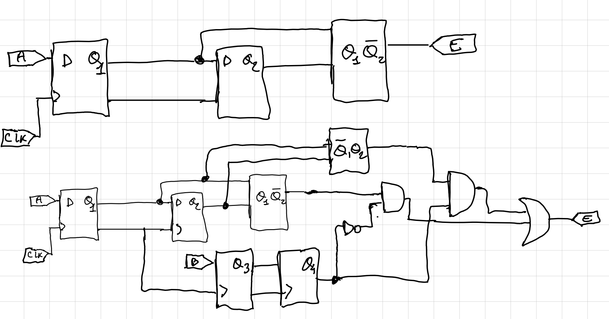

## En bref

| | |
|:--|:--|
| **Cadre** | Projet de TP FPGA, ENSEA, 2026–2027 |
| **Équipe** | Binôme |
| **Outils** | VHDL, Quartus Prime, NVC, Surfer, testbenches |

## Objectif

Reproduire en numérique l'**écran magique** (télécran) : deux boutons rotatifs déplacent un stylet qui dessine sur un écran. Le projet est réalisé en binôme sur une carte **DE10-Nano** (FPGA Intel Cyclone V SoC **5CSEBA6U23I7**) équipée d'une carte mezzanine avec deux encodeurs rotatifs et 10 LED. L'image est envoyée sur la sortie **HDMI** de la carte.

Chaque bloc est d'abord validé en **simulation** (testbench VHDL, NVC et Surfer), puis testé sur la carte après synthèse et affectation des broches sous **Quartus**.

## Architecture

```{mermaid}
flowchart LR
    ENC_G[Encodeur gauche] --> DEC_X[Décodeur quadrature X]
    ENC_D[Encodeur droit] --> DEC_Y[Décodeur quadrature Y]
    DEC_X -- "x stylet" --> RAM[Mémoire d'image<br/>double port]
    DEC_Y -- "y stylet" --> RAM
    CTRL[Contrôleur HDMI<br/>HS / VS / DE] -- "adresse pixel" --> RAM
    RAM -- "couleur" --> ADV[Puce HDMI ADV7513]
    CTRL -- "signaux de synchro" --> ADV
    ADV --> ECRAN([Écran])
```

## Décodage des encodeurs en quadrature

Un encodeur rotatif fournit deux signaux A et B décalés d'un quart de période : l'ordre dans lequel ils changent donne le sens de rotation. Le décodeur détecte les fronts montants et descendants de A et B et incrémente ou décrémente un compteur de taille configurable (`generic`).

* **Synchronisation** : A et B sont asynchrones, ils passent par un registre à deux bascules avant toute détection de front pour éviter la métastabilité.
* **Anti-rebond** : sur la carte, un seul cran faisait varier le compteur de plusieurs unités à cause des rebonds mécaniques. J'ai ajouté un paramètre `G_TICK_DIV` qui sous-échantillonne A et B (1 ms pour une horloge à 50 MHz), ce qui supprime les rebonds sans manquer de cran.
* **Bornage** : le compteur sert de coordonnée au stylet, il doit donc rester dans les dimensions de l'image au lieu de déborder d'un bord à l'autre.

{width=80%}


## Contrôleur vidéo HDMI

Le contrôleur génère les signaux de synchronisation horizontale et verticale (`HS`, `VS`) et le signal `Data Enable` attendus par la puce ADV7513, pour une résolution de 720 × 480. Il fournit aussi l'adresse et les coordonnées (x, y) du pixel en cours d'affichage, utilisées pour lire la mémoire d'image. Les timings (front porch, sync, back porch) sont des paramètres génériques du composant.

## Outils

**VHDL**, **Quartus Prime** (synthèse, Pin Planner), **NVC** et **Surfer** (simulation et chronogrammes), testbenches et scripts de simulation.

<div style="margin-top: 40px; text-align: center;">
  <a href="../projets.qmd" class="btn btn-outline-secondary">
    <i class="bi bi-arrow-left"></i> Retour aux projets
  </a>
</div>
